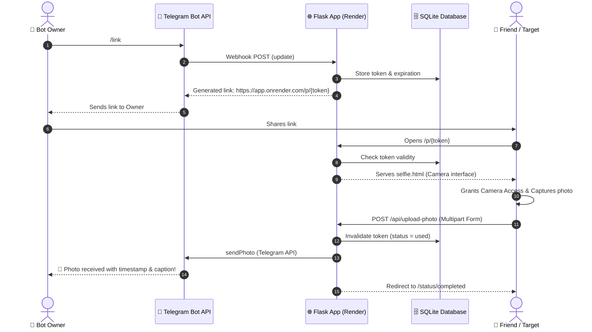

<div align="center">

# 📸 PrankBot — Consent-Based Selfie Telegram Bot

[](https://python.org)
[](https://flask.palletsprojects.com/)
[](https://core.telegram.org/bots/api)
[](https://render.com)
[](LICENSE)

> A modern, lightweight Flask & Telegram bot designed for friendly prank links that capture verified, consent-based selfie photos with live camera preview and instant Telegram delivery.

[Features](#-key-features) • [Workflow](#-architecture--workflow) • [Bot Commands](#-bot-commands) • [Environment Variables](#-configuration--environment-variables) • [Deployment](#-deployment-guide) • [Security & Privacy](#-security--privacy-principles)

</div>

---

## 🎯 Overview

**PrankBot** lets you generate unique, time-limited, single-use web links directly from your Telegram bot. When your target opens the link:
1. They arrive at a friendly, responsive web application.
2. They are informed that a selfie will be taken and forwarded to the link creator.
3. Once they grant camera permissions, a live viewfinder displays their camera feed.
4. After capturing their selfie, they can review or retake it before explicitly confirming submission.
5. The photo is instantly relayed directly to your private Telegram chat, and the link self-destructs.

---

## ✨ Key Features

- 🔒 **Consent-First Architecture**: Strictly respects user permissions — requests camera access clearly, displays live preview, and requires user confirmation before uploading.
- ⚡ **Single-Use Ephemeral Links**: Each generated URL is bound to a secure random token (`secrets.token_urlsafe`) that expires after a configurable TTL (default: 60 mins) and immediately invalidates upon use.
- 🤖 **Telegram Webhook Integration**: Fully synchronized Telegram Bot webhook secured with custom `X-Telegram-Bot-Api-Secret-Token` validation.
- 🛡️ **Built-in Rate Limiting & Admin Protections**: Sliding window rate-limiting per client IP and protected administrative routes via constant-time HMAC key checks (`X-Owner-Key`).
- 📊 **Audit & Activity Tracking**: Built-in SQLite database recording lifecycle events (link created, link opened, photo uploaded, link expired) and access metrics (`/stats`).
- 📱 **Mobile-Optimized Responsive UI**: Clean, modern CSS styling tailored for all mobile browsers (iOS Safari, Android Chrome).

---

## 🔄 Architecture & Workflow



---

## 💬 Bot Commands

All commands are restricted to the verified `OWNER_CHAT_ID`:

| Command | Description |
| :--- | :--- |
| `/start` | Welcome message and quick start instructions. |
| `/link` | Generates a new single-use prank selfie link with an expiration countdown. |
| `/stats` | Displays real-time statistics: active links, used links, and total events. |
| `/cancel <token>` | Manually revokes and deactivates an active link. |
| `/help` | Detailed command breakdown and security guidelines. |

---

## ⚙️ Configuration & Environment Variables

Configure these variables in your hosting provider (e.g., **Render Dashboard → Environment**):

| Variable | Required | Default | Description |
| :--- | :---: | :---: | :--- |
| `TELEGRAM_BOT_TOKEN` | **Yes** | — | Bot token created via [@BotFather](https://t.me/BotFather). Keep it strictly secret. |
| `TELEGRAM_BOT_USERNAME` | **Yes** | `PrankhimBot` | Public username of the bot (without `@`). |
| `OWNER_CHAT_ID` | **Yes** | — | Numeric Telegram ID of the authorized administrator (owner). |
| `PUBLIC_BASE_URL` | **Yes** | — | Public HTTPS URL where the Flask app is deployed (e.g. `https://prankbot.onrender.com`, without trailing slash). |
| `TELEGRAM_WEBHOOK_SECRET` | **Yes** | — | High-entropy string (32+ chars) used to authenticate incoming Telegram webhooks. |
| `OWNER_ADMIN_KEY` | **Yes** | — | Secure random passphrase to access administrative endpoints (`/admin/*`). |
| `DATABASE_PATH` | No | `/tmp/prankbot.sqlite3` | File path for the SQLite database. |
| `LINK_TTL_MINUTES` | No | `60` | Duration (in minutes) before a link automatically expires. |
| `MAX_PHOTO_BYTES` | No | `26214400` (25MB) | Maximum payload file size accepted for selfie uploads. |
| `RATE_LIMIT_PER_MINUTE` | No | `24` | Maximum API requests allowed per client IP per minute window. |
| `PORT` | No | `10000` | Web server listening port. |

---

## 🚀 Deployment Guide

### Option 1: One-Click Deploy via Render Blueprint

This repository includes a [`render.yaml`](render.yaml) specification:

1. Fork or push this repository to your GitHub account.
2. Log in to [Render](https://render.com) and go to **Blueprints**.
3. Connect your repository — Render will automatically detect [`render.yaml`](render.yaml).
4. Fill in the required environment values in the dashboard.
5. Click **Apply**.

---

### Option 2: Manual Web Service Setup on Render

1. Create a new **Web Service** on Render connected to your repository.
2. Configure the build parameters:
   - **Environment**: `Python 3`
   - **Build Command**: `pip install -r requirements.txt`
   - **Start Command**: `gunicorn app:app --workers 1 --threads 4 --timeout 60`
3. Add all the environment variables listed in the configuration table.
4. Deploy the service and retrieve its public URL (e.g., `https://prankbot.onrender.com`).
5. Ensure `PUBLIC_BASE_URL` matches this URL.

---

### 🔗 Configuring the Telegram Webhook

Once your application is online:

```bash
# Register the webhook with Telegram
curl -X POST "https://YOUR-APP.onrender.com/admin/set-webhook" \
  -H "X-Owner-Key: YOUR_OWNER_ADMIN_KEY"
```

Expected response:
```json
{
  "ok": true,
  "result": {
    "url": "https://YOUR-APP.onrender.com/telegram/webhook"
  }
}
```

To unregister or remove the webhook if needed:
```bash
curl -X POST "https://YOUR-APP.onrender.com/admin/delete-webhook" \
  -H "X-Owner-Key: YOUR_OWNER_ADMIN_KEY"
```

---

## 💻 Local Development

1. **Clone the repository:**
   ```bash
   git clone https://github.com/Badley08/PrankBot.git
   cd PrankBot
   ```

2. **Create and activate a virtual environment:**
   ```bash
   python3 -m venv .venv
   source .venv/bin/activate
   pip install -r requirements.txt
   ```

3. **Set up local environment variables (`.env`):**
   ```bash
   export TELEGRAM_BOT_TOKEN="your_bot_token"
   export TELEGRAM_BOT_USERNAME="PrankhimBot"
   export OWNER_CHAT_ID="your_telegram_id"
   export PUBLIC_BASE_URL="http://localhost:5000"
   export TELEGRAM_WEBHOOK_SECRET="local_dev_webhook_secret_32_chars"
   export OWNER_ADMIN_KEY="local_dev_admin_key"
   ```

4. **Run the Flask application:**
   ```bash
   python app.py
   ```
   *(For testing webhooks locally, consider using tools like [ngrok](https://ngrok.com) or [Cloudflare Tunnels](https://developers.cloudflare.com/pages/how-to/preview-with-cloudflare-tunnel/).)*

---

## 🛡️ Security & Privacy Principles

- 🚫 **No Persistent File Storage**: Photos received are streamed directly to Telegram's secure media servers. No photo files are written to disk or stored on the hosting server.
- 🔐 **Zero Credential Leaks**: Bot tokens and admin keys are never logged in telemetry or event tables.
- ⏳ **Atomic Link Consumption**: Links are marked as used in SQLite before dispatching to Telegram, guaranteeing links cannot be replayed or abused twice.
- 🪪 **Owner Whitelisting**: Telegram commands ignore all incoming messages unless they originate from the explicit `OWNER_CHAT_ID`.

---

## 📄 License

This project is open-source under the [MIT License](LICENSE). Built for educational and ethical entertainment purposes.
