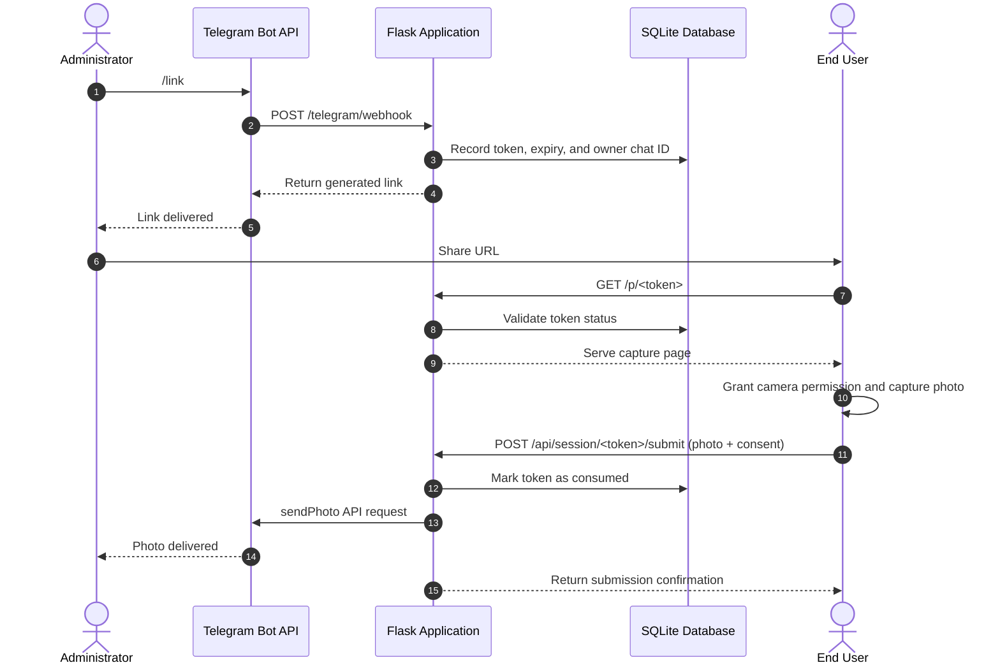

# Telegram Selfie Bot

A Flask web application and Telegram bot service designed for generating single-use, time-limited selfie capture links with explicit user consent and instant Telegram dispatch.

> [!NOTE]
> This service requires explicit camera permissions from the browser and confirmation from the end user before any image payload is transmitted to the bot administrator.

---

## Architecture Overview

The system consists of two primary components:
1. **Telegram Webhook Receiver**: Processes administrator commands and dispatches notifications via the Telegram Bot API.
2. **Flask Web Application**: Serves the camera capture interface, handles token validation, enforces rate limits, and transmits submitted image files directly to the designated Telegram chat.



---

## Key Features

- **Consent-Enforced Workflow**: The client-side interface requires user interaction, camera permission approval, and explicit confirmation before uploading.
- **Single-Use Cryptographic Tokens**: Links use tokens generated via Python `secrets.token_urlsafe`, expiring after a configurable time-to-live (TTL) and consumed immediately upon submission.
- **HMAC Webhook Verification**: Telegram updates are validated using the `X-Telegram-Bot-Api-Secret-Token` header.
- **Role-Based Command Execution**: Bot commands are strictly locked to the configured `OWNER_CHAT_ID`.
- **Sliding Window Rate Limiting**: Built-in SQLite-backed rate limiting protects against request flooding.
- **Zero Persistent File Storage**: Uploaded images are streamed directly to Telegram API endpoints without persisting to the local filesystem.

> [!IMPORTANT]
> The server environment does not write photo files to permanent disk storage. Images are held in memory during the request cycle and forwarded directly to Telegram servers.

---

## Bot Command Reference

All commands require communication with the configured bot handle from the account matching `OWNER_CHAT_ID`:

| Command | Arguments | Description |
| :--- | :--- | :--- |
| `/start` | None | Displays service summary and operational overview. |
| `/link` | None | Generates a single-use URL with an expiration countdown. |
| `/stats` | None | Returns database metrics regarding total, active, and consumed links. |
| `/cancel` | None | Deactivates all currently active links associated with the administrator. |
| `/help` | None | Displays command syntax and reference information. |

---

## Configuration Variables

Configure the following environment variables on your hosting platform:

| Variable | Type | Default | Description |
| :--- | :--- | :--- | :--- |
| `TELEGRAM_BOT_TOKEN` | String | *Required* | API authentication token provided by BotFather. |
| `TELEGRAM_BOT_USERNAME` | String | `PrankhimBot` | Public username of the Telegram bot without the `@` prefix. |
| `OWNER_CHAT_ID` | Integer | *Required* | Numeric Telegram chat identifier of the authorized administrator. |
| `PUBLIC_BASE_URL` | String | *Required* | Public HTTPS base URL of the deployed application (e.g., `https://example.onrender.com`). |
| `TELEGRAM_WEBHOOK_SECRET` | String | *Required* | Random secret string (minimum 32 characters) used to verify incoming Telegram webhooks. |
| `OWNER_ADMIN_KEY` | String | *Required* | Passphrase used to authenticate administrative endpoints via the `X-Owner-Key` header. |
| `DATABASE_PATH` | String | `/tmp/prankbot.sqlite3` | File system location for the SQLite database. |
| `LINK_TTL_MINUTES` | Integer | `60` | Duration in minutes before an active link expires. |
| `MAX_PHOTO_BYTES` | Integer | `26214400` | Maximum file size allowed for uploads in bytes (default: 25 MB). |
| `RATE_LIMIT_PER_MINUTE` | Integer | `24` | Maximum allowable requests per client IP address per minute. |
| `PORT` | Integer | `10000` | Local network port for the HTTP server. |

> [!WARNING]
> On platforms with ephemeral filesystems (such as standard Render web services), files stored in `/tmp` are reset during restarts and re-deployments. For persistent token histories, configure a persistent disk or migrate the database layer to PostgreSQL.

---

## Deployment Instructions

### Deployment on Render

1. Connect your repository to Render as a **Web Service**.
2. Configure build and execution settings:
   - **Environment**: Python 3
   - **Build Command**: `pip install -r requirements.txt`
   - **Start Command**: `gunicorn app:app --workers 1 --threads 4 --timeout 60`
3. Input the required environment variables in the environment settings section.
4. Deploy the service and record the assigned HTTPS domain.
5. Set `PUBLIC_BASE_URL` to the assigned domain and redeploy.

### Webhook Configuration

After deployment, initialize the Telegram webhook using the administrative API:

```bash
curl -X POST "https://YOUR-APP.onrender.com/admin/set-webhook" \
  -H "X-Owner-Key: YOUR_OWNER_ADMIN_KEY"
```

A successful registration returns:

```json
{
  "ok": true,
  "result": true,
  "webhook_url": "https://YOUR-APP.onrender.com/telegram/webhook"
}
```

To remove the webhook registration:

```bash
curl -X POST "https://YOUR-APP.onrender.com/admin/delete-webhook" \
  -H "X-Owner-Key: YOUR_OWNER_ADMIN_KEY"
```

> [!TIP]
> Always verify that `PUBLIC_BASE_URL` begins with `https://`. Telegram rejects non-HTTPS webhook URLs.

---

## Local Development Setup

1. Clone the repository:
   ```bash
   git clone https://github.com/Badley08/PrankBot.git
   cd PrankBot
   ```

2. Create and activate a virtual environment:
   ```bash
   python3 -m venv .venv
   source .venv/bin/activate
   pip install -r requirements.txt
   ```

3. Export local environment variables:
   ```bash
   export TELEGRAM_BOT_TOKEN="your_telegram_bot_token"
   export TELEGRAM_BOT_USERNAME="PrankhimBot"
   export OWNER_CHAT_ID="your_numeric_chat_id"
   export PUBLIC_BASE_URL="http://localhost:5000"
   export TELEGRAM_WEBHOOK_SECRET="random_development_secret_string_32_chars"
   export OWNER_ADMIN_KEY="random_admin_access_key"
   ```

4. Run the development server:
   ```bash
   python app.py
   ```

---

## Security Specifications

- **Immediate Token Invalidation**: A link token is marked as consumed before the Telegram dispatch occurs. If the Telegram API fails or times out, the link cannot be reused.
- **Timing-Safe Comparison**: Webhook secrets and administrative keys are evaluated using `hmac.compare_digest` to prevent timing attacks.
- **Content-Length Enforcements**: Incoming uploads are capped at the application level to prevent memory exhaustion.
- **Strict Role Verification**: Every webhook message checks `OWNER_CHAT_ID` prior to running sensitive commands.
